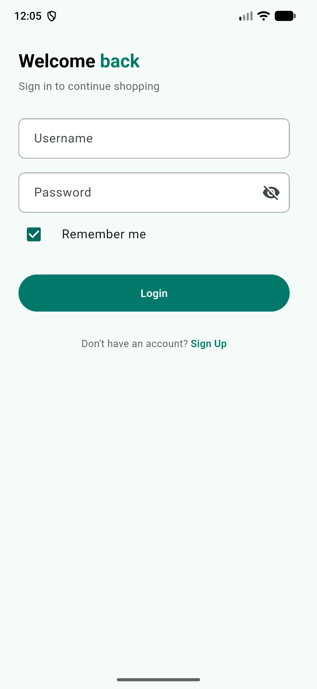
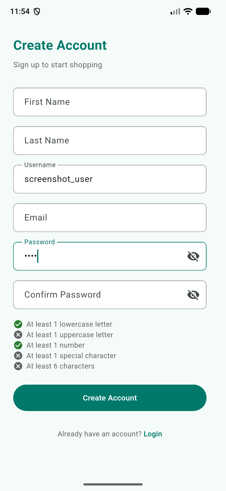
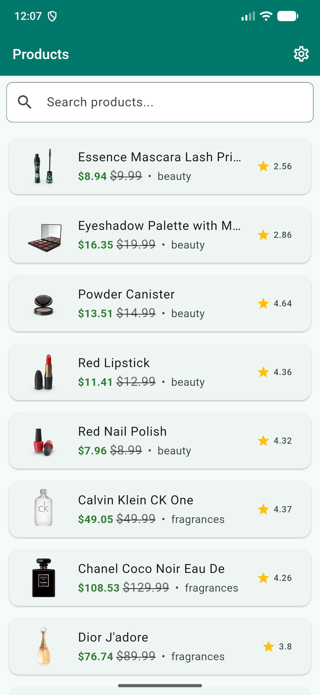
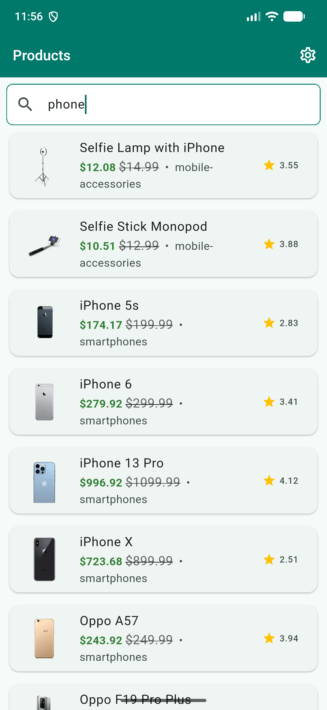
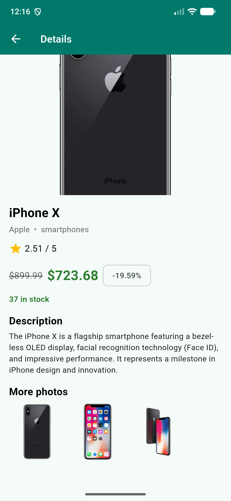
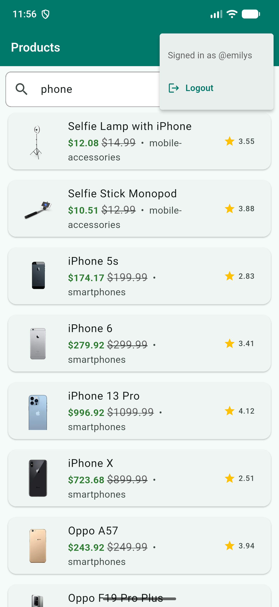

<h1 align="center">🛍️ DummyJSON Store</h1>

<p align="center">
  A Flutter e-commerce demo app (Android + Web) built as part of the <b>DEPI</b> training program.<br/>
  It talks to the free <a href="https://dummyjson.com">DummyJSON</a> fake REST API and covers the full shopping journey:<br/>
  <b>log in → browse products → search → view details → log out</b>.
</p>

<p align="center">
  <a href="https://flutter.dev"></a>
  <a href="https://dart.dev"></a>
  
  
  
</p>

> **In one sentence:** a small, cleanly-architected shopping app that shows how a real Flutter app handles authentication (with automatic token refresh), product listing, and state management — built for learning, written for readers.

## What the app does

| Feature | What happens |
|---|---|
| **Splash auto-login** | On launch the app checks the saved session; a valid session skips login and lands straight on the products screen. |
| **Login** | Real token authentication against the API. Wrong credentials show a friendly error banner. |
| **Sign up** | A validated form with a **live password checklist** (length, capital letter, number…). Accounts are simulated by the fake API — the flow ends back on login with the username prefilled. |
| **Products** | The app's home after login: a scrollable product list with images, prices, and categories. |
| **Search** | Debounced search (500 ms) so the API is not hammered per keystroke. |
| **Product details** | Full product page: image, price with discount, stock, description — with a Back button. |
| **Settings menu** | A gear icon in the app bar opens a popup with the signed-in username and a **Logout** action that wipes the session. |
| **Token refresh** | An auth interceptor refreshes an expired access token automatically (once per request) and replays the failed call. If the session is truly dead, the app cleans up and returns to login with a "session expired" banner. |

## Screenshots

Real captures from the Android emulator — every screen of the journey:

<p align="center"><b>Splash · Login · Sign up</b></p>

| Splash | Login | Sign up |
|:---:|:---:|:---:|
|  |  |  |

<p align="center"><b>Shopping · Logout</b></p>

| Products | Search | Details | Settings popup |
|:---:|:---:|:---:|:---:|
|  |  |  |  |

## Try it yourself

1. Install [Flutter](https://docs.flutter.dev/get-started/install), then:
   ```bash
   flutter pub get
   flutter run                # on a connected Android device/emulator
   flutter run -d chrome      # or on the web
   ```
2. Log in with the fake-API demo account:

> [!NOTE]
> **Demo account:** username **`emilys`** — password **`emilyspass`** (any account from the DummyJSON docs works). Sign-up creates a *simulated* account — the form, validation, and checklist are real, the backend is not.

## How it is built

**Feature-first, layered architecture.** Every feature follows the same path, and the UI never skips layers:

```
features/<feature>/ui  →  logic (Cubit)  →  data (Repository)  →  ApiService (Dio)
```

```
lib/
├── core/                  # cross-feature code
│   ├── di/                # get_it service locator (the ONLY registration point)
│   ├── networking/        # Dio, endpoints, ApiResult, and the AuthInterceptor
│   ├── routing/           # named routes + router
│   ├── helpers/           # secure storage (tokens), shared prefs (user), constants
│   ├── theming/           # colors + text styles (no hardcoding in screens)
│   └── widgets/           # shared loading/error/empty views, fields, buttons
└── features/
    ├── splash/            # session restore on launch
    ├── login/             # token login + session-expired banner
    ├── sign_up/           # registration form + live password checklist
    ├── settings/          # app-bar popup: signed-in user + logout
    ├── products/          # list + debounced search
    └── product_details/   # one product's full page
```

**State management:** `Cubit` in every feature — plain methods the UI calls (`cubit.fetchProducts()`), states extending `Equatable`, `BlocBuilder`/`BlocListener` in the UI.

**The token flow (the interesting part):** one `QueuedInterceptor` on the shared Dio instance:
- attaches `Authorization: Bearer <token>` to every non-auth request, reading from **encrypted storage** (`flutter_secure_storage`);
- on `401/403`, trades the refresh token for a new pair **once per request** (queued requests coordinate so parallel failures never trigger parallel refreshes), then replays the original call;
- if the refresh itself is rejected, it clears both storage boxes and fires a callback (registered in the DI setup — the interceptor never touches navigation) that routes the user to login with a session-expired banner.

## Tech stack

- **Flutter** (Android + Web) — Dart
- **flutter_bloc** (Cubit) for state management
- **Dio** for networking (+ custom auth interceptor)
- **get_it** for dependency injection
- **flutter_secure_storage** (encrypted access/refresh tokens) + **shared_preferences** (user profile)
- **Equatable** for value-comparable states
- **flutter_test** for unit & widget tests (77 tests), plus a separate end-to-end suite run on a real emulator and on the web

## Project docs

- [`PRODUCT.md`](PRODUCT.md) — what the product is, who it is for, and its North Star.
- [`DESIGN.md`](DESIGN.md) + [`.impeccable/design.json`](.impeccable/design.json) — the design system: colors (Confident Teal `#00796B`), spacing scale, WCAG ≥ 4.5:1 contrast rule.
- [`AGENTS.md`](AGENTS.md) — conventions and commands for anyone (human or AI) working in this codebase.

## Notes

- This is a **training/portfolio project**: the backend is DummyJSON's fake API, so products, logins, and sign-ups are simulated on their server. The engineering around them (architecture, token handling, error states, testing) is real.
- No real user data is collected or stored anywhere — tokens live only on the device, encrypted.
